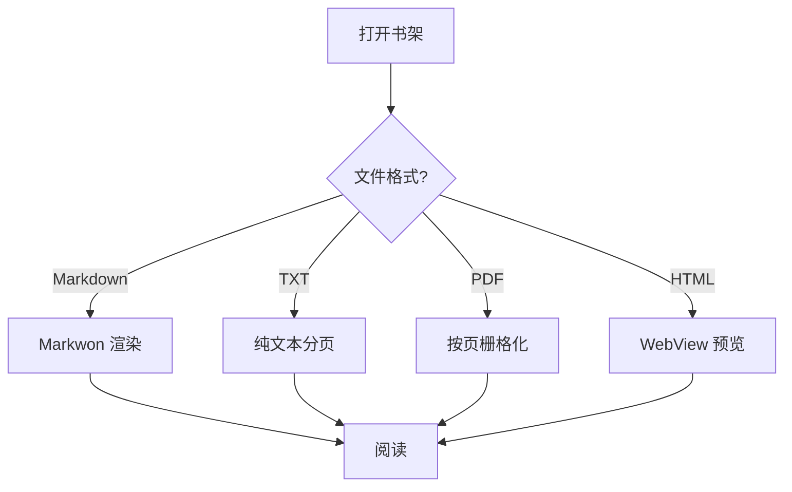
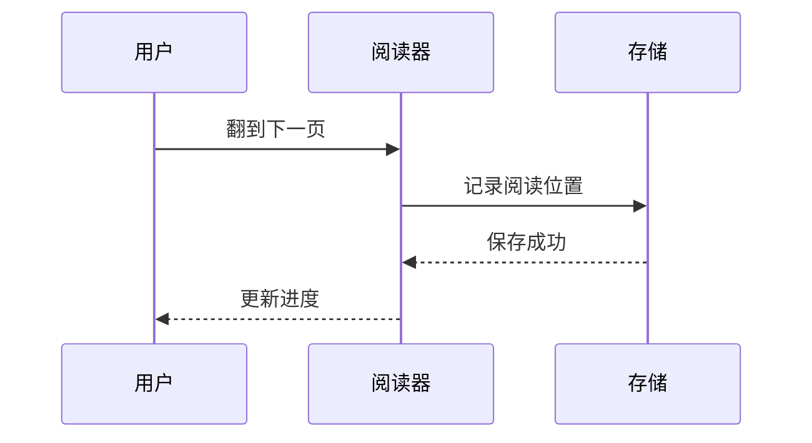

# MD 阅读器 · Markdown 全功能测试

> 本文用于逐项验证 Markdown 渲染、目录、链接、代码块、表格、图片、公式与图表。
> 建议逐章阅读，并测试「目录跳转」「划线/书签」「字号与行距切换」「深色主题」。

## 一、基础排版

普通段落。这里有**粗体**、*斜体*、***粗斜体***、~~删除线~~、`行内代码`，以及行内公式 $a^2 + b^2 = c^2$ 和 $\alpha \to \beta$。

换行测试：本行末尾有两个空格，下一行应紧接本行。  
这一行是软换行后的第二行。

### 1.1 六级标题

#### 四级标题
##### 五级标题
###### 六级标题（最小）

## 二、链接

- 外部链接（点击应弹「即将打开外部网页」确认）：[Markdown 规范](https://commonmark.org/)
- 自动识别链接：https://developer.android.com/studio
- 邮件链接：[发邮件给测试账号](mailto:test@example.com)
- 站内锚点：[跳到「五、表格」](#五表格)
- 相对文件链接：[同目录的 HTML 测试页](./03-网页-HTML测试.html)
- 标题里的链接：[带链接的标题示例](https://example.com/title-link)

### 2.1 链接点击命中测试（重点）

下面几行专门用来验证「只有点在实际链接文字上才跳转」：

这一行开头是普通文字，接着是一个链接：[点我打开示例站](https://example.com/)，链接后面还有一大段普通文字，点这行两端都不应跳转。

[整行只有链接文字](https://example.com/only-link)

这一行的链接在最后：[文字在前，链接在尾](https://example.com/at-end)

- 列表项中的链接：[列表里的链接](https://example.com/list-link)，点前面的文字不跳转
- 引用中的链接：

> 引用块里也有一个链接：[引用里的链接](https://example.com/quote-link)，点引用块其他位置不应跳转。

| 说明 | 链接 |
|---|---|
| 表格单元格里的链接 | [表格链接](https://example.com/table-link) |

## 三、列表

### 3.1 无序列表（嵌套）

- 第一层 A
  - 第二层 A-1
    - 第三层 A-1-1
  - 第二层 A-2
- 第一层 B
- 第一层 C

### 3.2 有序列表

1. 第一步：打开书架
2. 第二步：导入文件
3. 第三步：开始阅读
   1. 子步骤：调字号
   2. 子步骤：切换翻页方式

### 3.3 任务列表

- [x] 验证 Markdown 渲染
- [x] 验证目录与跳转
- [ ] 验证划线、书签与统计
- [ ] 验证深浅色主题

## 四、引用与分割线

> 一级引用：阅读是把别人的思考，变成自己的台阶。
>
> > 二级引用：嵌套引用应保留缩进与竖线。
>
> 回到一级引用。

---

## 五、表格

| 左对齐 | 居中 | 右对齐 | 说明 |
|:-------|:----:|-------:|------|
| 文本 | 居中 | 1,024 | 普通单元格 |
| `code` | **粗体** | 2,048 | 支持行内格式 |
| [链接](https://example.com) | ~~删除~~ | 4,096 | 混合内容 |
| 很长的单元格内容用于测试换行与列宽自适应效果 | 中 | 8,192 | 自动换行 |

## 六、代码块

### 6.1 Kotlin

```kotlin
data class Chapter(
    val index: Int,
    val title: String,
    val offset: Int,
)

fun readingProgress(offset: Int, total: Int): Float =
    if (total <= 0) 0f else (offset.toFloat() / total).coerceIn(0f, 1f)
```

### 6.2 超长行（测试代码块横向滚动 / 自动换行）

```kotlin
val veryLongLine = "这是一行特别长的代码，用来验证关闭「代码块自动换行」后是否出现横向滚动条，以及开启换行后是否能完整展示全部内容。" + "这是拼接的第二段很长的内容，继续拉长这一行。" + "第三段内容，确保总宽度明显超过屏幕宽度，便于观察滚动行为。" + "第四段内容补充。"
```

### 6.3 Bash

```bash
#!/usr/bin/env bash
set -euo pipefail
adb push ./docs /sdcard/Download/MDReader-TestDocs
adb shell ls -l /sdcard/Download/MDReader-TestDocs
```

### 6.4 JSON

```json
{"versionName":"1.3.5","versionCode":37,"features":["markdown","txt","pdf","html","code"]}
```

## 七、公式

行内公式：质能方程 $E = mc^2$，欧拉恒等式 $e^{i\pi} + 1 = 0$。

块级公式：

$$
\int_{0}^{1} x^{2}\,\mathrm{d}x = \frac{1}{3}
$$

$$
\begin{pmatrix}
a & b \\
c & d
\end{pmatrix}
\begin{pmatrix}
x \\
y
\end{pmatrix}
=
\begin{pmatrix}
ax + by \\
cx + dy
\end{pmatrix}
$$

## 八、图表

### 8.1 Mermaid 流程图



### 8.2 Mermaid 时序图



### 8.3 ECharts 柱状图

```echarts
{
  "title": { "text": "各格式导入数量" },
  "tooltip": {},
  "xAxis": { "type": "category", "data": ["Markdown", "TXT", "PDF", "HTML", "Code"] },
  "yAxis": { "type": "value" },
  "series": [{ "type": "bar", "data": [12, 8, 3, 5, 9] }]
}
```

## 九、图片

网络图片（需要联网）：


SVG 网络图片：


> 若图片加载失败，多为网络原因；可对比「Git 项目」里的本地图片测试。

## 十、行内 HTML

- <u>下划线</u>、<b>粗体标签</b>、<i>斜体标签</i>
- 带颜色的文字：<span style="color:#c0392b">红色</span> / <span style="color:#1e8449">绿色</span>
- 换行标签：第一段<br>第二段
- 上下标：H<sub>2</sub>O、x<sup>2</sup>

## 十一、脚注

这里引用一个脚注[^1]，还有第二个[^2]。

[^1]: 这是第一条脚注的内容。
[^2]: 这是第二条脚注，用于验证脚注区域渲染与链接跳转。

## 十二、超长段落与表情

一段很长的正文，用来观察行宽、行距与两端对齐效果：夜色像一层缓慢下沉的水，把城市里所有的声音都压低了。远处的霓虹被雨水揉碎，沿着玻璃往下流，像一封写到一半就被迫中断的信。她坐在窗边，把书翻到上次折角的那一页，忽然意识到自己已经记不清故事的开头，却清楚地记得读到这里时窗外的风是什么味道。有些书是这样，读过之后情节会淡，气味和光线却留下来，变成你身体的一部分。

表情符号：😀 🎉 📚 ✅ ❌ 🔥

## 十三、图片占位与链接图片

[](https://example.com/image-link)

---
*文档结束。若以上都正常，Markdown 渲染即通过。*
