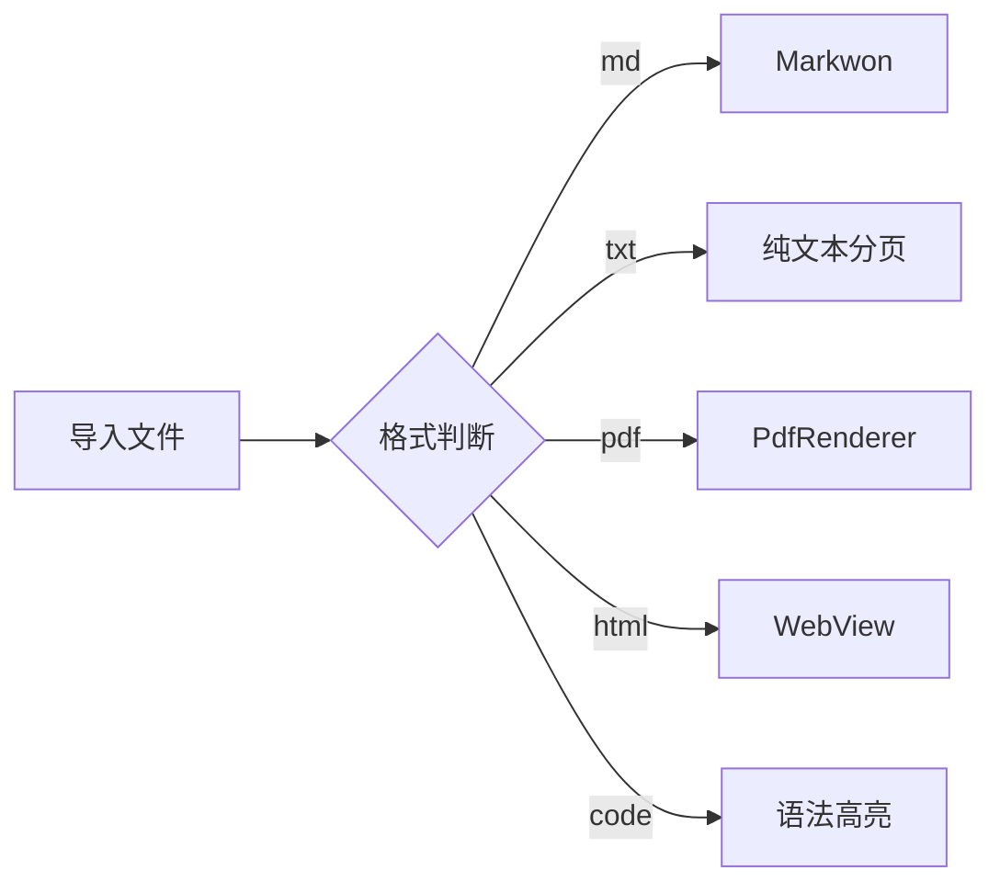
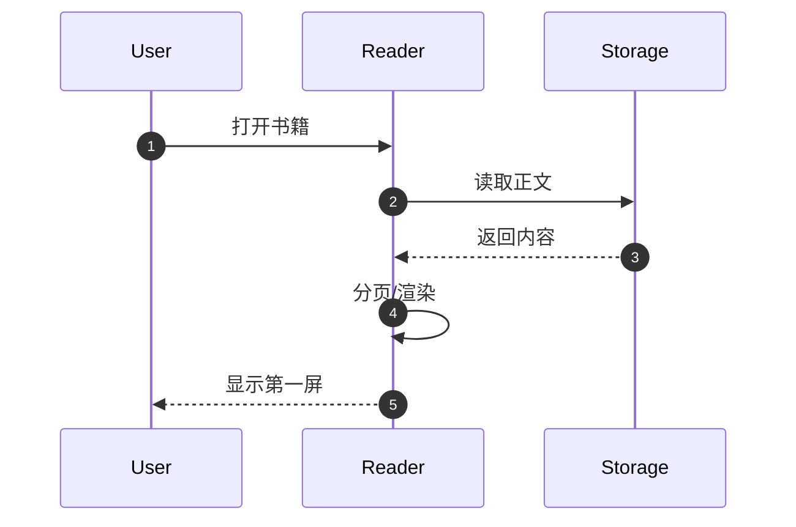
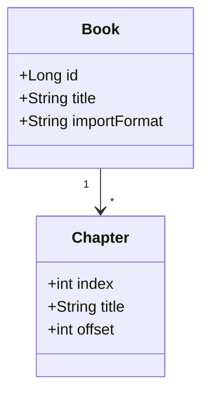

# 图表渲染测试

## Mermaid 流程图



## Mermaid 时序图



## Mermaid 类图



## ECharts 折线图

```echarts
{
  "title": { "text": "阅读时长（分钟）" },
  "tooltip": { "trigger": "axis" },
  "xAxis": { "type": "category", "data": ["周一", "周二", "周三", "周四", "周五", "周六", "周日"] },
  "yAxis": { "type": "value" },
  "series": [{ "type": "line", "smooth": true, "data": [25, 40, 18, 60, 45, 80, 70] }]
}
```

## chart 别名（等价 echarts）

```chart
{
  "title": { "text": "各格式占比" },
  "tooltip": {},
  "series": [{
    "type": "pie",
    "radius": ["40%", "70%"],
    "data": [
      { "value": 12, "name": "Markdown" },
      { "value": 8, "name": "TXT" },
      { "value": 3, "name": "PDF" },
      { "value": 5, "name": "HTML" },
      { "value": 9, "name": "Code" }
    ]
  }]
}
```

> 关注点：图表是否异步渲染出来、点击图表能否全屏预览、深色主题下的背景是否合适、渲染失败时是否有占位提示。
